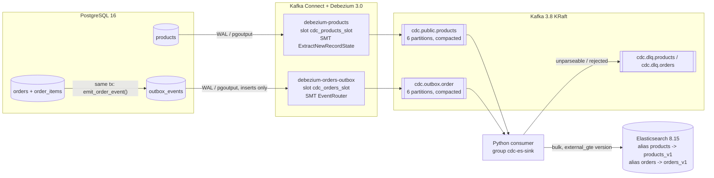

# CDC Search Sync architecture

PostgreSQL is the system of record. Elasticsearch is **derived data**: it can be
deleted and rebuilt from the Kafka log at any time, and it may lag the source by
a bounded, measured amount.

## Data flow



## Two capture styles

| | products | orders |
| --- | --- | --- |
| Capture | Raw CDC on the table | Transactional outbox ([ADR-0001](adr/0001-raw-cdc-products-outbox-orders.md)) |
| Why | 1 row = 1 document | Document = order + items; the join is done in the DB transaction, not in the consumer |
| Kafka key | `{"id": <pk>}` | `"<order id>"` |
| Version | `source.lsn` (`__lsn`) | `aggregateVersion` header (per-order sequence) |
| Snapshot | `snapshot.mode=initial` | `no_data`; history via `backfill_orders_outbox()` |
| Deletes | `__deleted="true"` + tombstone | payload `deleted: true` |

## Delivery semantics

- **At-least-once.** The consumer commits offsets only after each record in
  the batch has been acknowledged by Elasticsearch or written to the DLQ
  (`enable.auto.commit=false`, synchronous commit of `offset + 1` per partition).
- **Idempotent writes.** `_id` = primary key; `index` with
  `version_type=external_gte`. Replays and out-of-order duplicates get HTTP 409
  and count as success ([ADR-0002](adr/0002-external-versioning-lsn.md)).
- **Ordering.** Kafka key = PK, so all changes to one row stay in one partition
  in commit order. Partition counts are fixed
  ([ADR-0004](adr/0004-fixed-partitions-compaction.md)).
- **Within a batch** several changes to the same document collapse to the
  newest one (`coalesce()`). A TOAST partial update is folded into an earlier
  full document when one is present.

## Special event shapes

| Event | Consumer action |
| --- | --- |
| `c` / `u` / `r` | `index` the full document, external version |
| `u` with `__debezium_unavailable_value` (unchanged TOAST column) | scripted `update`: merges only the known fields, and only if the stored `cdc.version` is older |
| `d` (rewritten, before-image) | soft: `index` with `is_deleted=true`; hard: versioned `delete` ([ADR-0003](adr/0003-soft-delete.md)) |
| tombstone (`value=null`) | ignored if its delete is in the same batch, else mark/delete by id |
| bad JSON, missing LSN, base64 decimal, ES 4xx | DLQ with `dlq.*` headers, then commit |
| ES unreachable / 429 / 5xx | backoff with jitter, `pause()` partitions, keep polling, `resume()` when ES recovers |

## Back-pressure and rebalancing

While Elasticsearch is failing, the consumer pauses its partitions and keeps
calling `poll(0)`. That keeps it inside `max.poll.interval.ms` and lets rebalance
callbacks run. On `on_revoke` it tries to flush and commit within 10 s. If it
cannot, it drops the uncommitted records, and the new owner re-reads them.
SIGTERM triggers a final flush and commit before `close()`.

## Lag model

Each document carries `cdc.{source_ts, connector_ts, kafka_ts, consumed_at, indexed_at}`:

```text
PG commit ─source→ Debezium ─kafka→ Kafka ─consume→ consumer ─index→ ES ack ─refresh(≤1s)→ searchable
```

The consumer exports `cdc_lag_seconds{stage=source|kafka|consume|index|e2e}` as
histograms. `benchmark/measure_lag.py probe` measures commit-to-searchable from
outside the pipeline.

## Protecting the primary database

- `max_slot_wal_keep_size = 2GB`: a dead connector can retain at most 2 GB of
  WAL. After that the slot becomes `lost` and the database stays healthy.
  Recovery: [runbook](runbook.md#slot-lost).
- `heartbeat.action.query` advances each slot even when the captured tables are idle.
- Debezium uses a dedicated `REPLICATION` role with `SELECT` only on the captured tables.
- The pgbench comparison (`benchmark/pgbench/compare.sh`) measures how much CDC
  costs the primary.

## Rebuild

Topics are compacted, so they always hold the latest state of every key. To
rebuild, replay into `<entity>_v<N+1>` with a new consumer group and then swap
the alias atomically. See `elasticsearch/reindex.sh` and
[runbook](runbook.md#rebuild-index).
